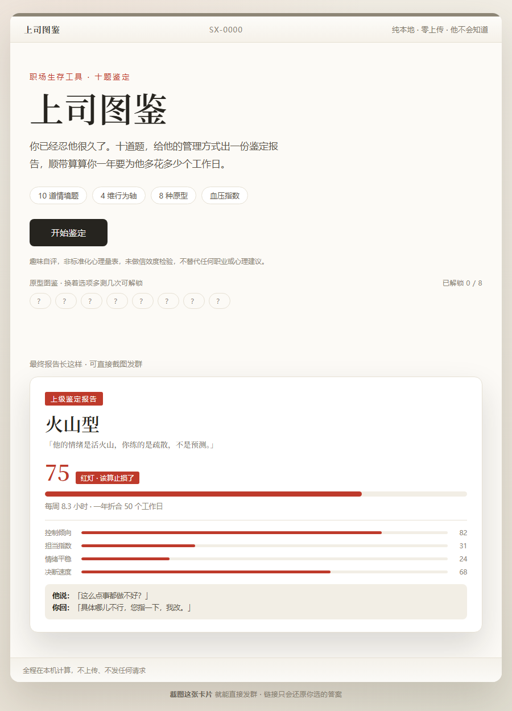

# 上司图鉴

> 他不是针对你，他只是对谁都这样。——但代价是你来付。

[](./LICENSE) [](./assets/shangsi-tujian.html) [](./SKILL.md)

**🔗 [在线体验 →](https://tomatoribs.github.io/shangsi-tujian/)**（点开就玩 · 免安装 · 免注册）



一个 59 KB 的单文件 HTML，双击就开，断网也能玩，手机浏览器直接适配。页面右上角写着它的立场：**纯本地 · 零上传 · 他不会知道。**

总有些管理方式，你明明被消耗了，却拿不出任何证据。10 道情境题，给他的管理方式出一份鉴定报告，顺带算算你一年要为他多花多少个工作日。

**10 道情境题 · 4 维行为轴 · 8 种原型 · 血压指数 · 0 上传**

## 你会测出什么

| 原型 | 特点 |
|---|---|
| 显微镜型 | 事无巨细都要过目，改到第八版说还是第一版好 |
| 甩锅风筝 | 出事就放线，有功就收线轴 |
| 摘桃侠 | 项目上线那天，他第一个发言 |
| 神隐菩萨 | 平时不现身，关键时刻也不现身 |
| 火山型 | 情绪全靠你猜，爆发时间随机 |
| 画饼仙人 | 饼有多大，兑现率就有多小 |
| 变色龙 | 对上一套说法，对下另一套说法 |
| 铁腕型 | 说了就算，效率极高，但没人情缓冲 |

原型图鉴逐个解锁，换着选项多测几次能集齐 8 个。

## 报告卡里有什么

四个维度打分：**控制倾向、担当指数、情绪平稳、决断速度**，合并成 **血压指数**（绿 / 黄 / 红三档，红灯档写着「该算止损了」）。

血压越高，折算越大：每周额外小时数 = 血压指数 ÷ 100 × 11，一年按 48 周、每个工作日 8 小时折算。页面内置的示例卡是这么展示的：**血压 75（红灯）→ 每周 8.3 小时 → 一年折合 50 个工作日**——报告卡里最容易一张图说清的数字。

另有「**他说 · 你回**」（他常挂嘴边的话，和你可以怎么回——给情绪留的出口，真要说出口前，建议先在心里过一遍）、「**三年推演**」（长期走向）和「**保命清单**」（可落地的自我保护动作）。

## 效果示例

以下直接摘自页面首屏内置的示例报告卡（未做任何修改）：

```text
┌──────────────────────────────────────────────┐
│  上级鉴定报告                                │
│  原型：火山型                                │
│  「他的情绪是活火山，你练的是疏散，不是预测。」│
│                                              │
│  75   红灯 · 该算止损了                      │
│  每周 8.3 小时 · 一年折合 50 个工作日        │
│                                              │
│  控制倾向  ████████░░  82                    │
│  担当指数  ███░░░░░░░  31                    │
│  情绪平稳  ██░░░░░░░░  24                    │
│  决断速度  ██████░░░░  68                    │
│                                              │
│  他说：「这么点事都做不好？」                │
│  你回：「具体哪儿不行，您指一下，我改。」    │
└──────────────────────────────────────────────┘
```

## 怎么用

1. 双击 `assets/shangsi-tujian.html`（无需联网、无需服务器，手机可直接打开）。
2. 点选 10 道情境题，每题点完自动进入下一题。
3. 第十题后可给上级起个名（可跳过），生成报告，截图或链接分享。

## 隐私

全部计算在浏览器本地完成，零上传。上级姓名只存在你本机的 `localStorage`，关掉页面还在，清掉浏览器数据即消失。分享链接只会还原你选的答案——**转发链接等同于公开你的答案**，发给谁，请确认后再定。

## 别拿它干什么

- 不要发给本人，不要贴进公司群——鉴定是为了你自己看清，不是为了让他看到
- 上级名字建议留空或用绰号
- 不要作为绩效申诉、劳动仲裁或离职谈判的材料
- 如果你的领导其实挺好的——那恭喜，这个工具用不上，但可以给个 Star

## 工位生存指南 · 六件套

| 现在的状况 | 玩哪个 | 花多久 |
|---|---|---|
| 想知道消耗的源头是谁 | **上司图鉴（你在这）** | 3 分钟 |
| 想知道到底有多想走 | [跑路指数测试](https://github.com/TomatoRibs/want-to-quit-index) | 6 分钟 |
| 想给某个同事开庭 | [同事判刑书](https://github.com/TomatoRibs/workplace-verdict) | 3 分钟 |
| 只想先给环境做个体检 | [工位窒息指数](https://github.com/TomatoRibs/workplace-suffocation-index) | 30 秒 |
| 什么也不想干 | [摸鱼签筒](https://github.com/TomatoRibs/moyu-qiantong) | 摇一签 |
| 下午有一场会 | [车祸大会 Bingo](https://github.com/TomatoRibs/huoche-dahui-bingo) | 一场会 |

## 可二创

8 个原型的名字、吐槽、三年推演、他说你回，全部集中在 `assets/shangsi-tujian.html` 源码里——改两行，就是「你们部门的老板图鉴」。

## 为什么做这个

它的用处只有一个：把「我是不是太敏感了」换成一张写满数字的纸。

## 装成 WorkBuddy 技能（可选）

```bash
bash scripts/install_local.sh .
```

WorkBuddy 是一个本地 AI 助手；装成技能后，一句话触发：「做一个能鉴定 8 种老板原型、能算出一年搭进去多少工作日的网页」。

## 免责声明

本工具是基于日常职场观察的原创题目设计的解压自评玩具，**不是标准化心理量表，未做信效度检验，不做临床诊断**。结果仅供娱乐与自我觉察，不构成对任何具体个人的评价，也不构成职业或心理建议。「他说 · 你回」为情绪化文字游戏，不构成任何沟通建议。

## 作者 · 许可证

番茄排骨 · [MIT](./LICENSE)

集齐 8 种原型之后，回来点个 Star——据说能让血压降一点（并不能）。

> 看清他，是为了保住你自己。
